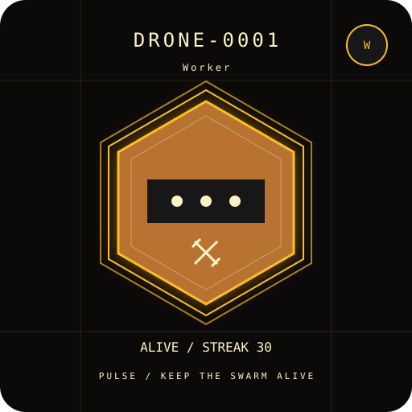
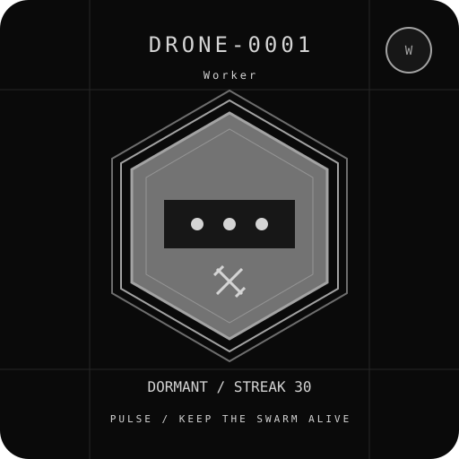

# Onchain art samples

`alive.svg` and `dormant.svg` were decoded from the actual `PulseDrone.tokenURI(1)`
output in a local Foundry fixture. The fixture minted a Drone, deposited 2,000
PULSE, and maintained 30 heartbeats. It then advanced to one second past the
48-hour survival window. Both states have the same seed, traits and deposited
balance. The JSON files contain the complete decoded metadata, including the
base64 images.

These are local examples, not a live deployment or assigned production token ID.
The assets were checked with strict RFC 4648 decoding, Python's JSON parser and
its XML parser. The Dormant SVG contains only greyscale colors and no animation.

| Alive | Dormant |
| --- | --- |
|  |  |
